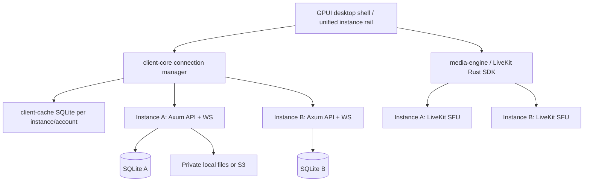

# Whisk — Architecture — proposed v1 system

Whisk Desktop (Rust + GPUI) connects to Whisk Server instances (Rust + Axum) and uses LiveKit for voice and streaming. These names describe deployment roles; instance IDs are server-generated UUIDs, not the literal brand name.

## Invariants

- One backend **instance** deploys one **community** in v1, with `community_id` modeled for future multi-community hosting.
- One native Rust/GPUI app can maintain several independent authenticated **instance profiles** in a Discord-like sidebar; **no federation or shared identity**.
- The native app may maintain WS connections to multiple instances, but only **one voice channel connection** is active globally per client.
- Instances hold their own user database, channels, DMs, private attachment store, and LiveKit service.
- A user's local cache key is `(instance_id, account_id)` and every event cursor is instance-scoped.



## Proposed Rust workspace

```text
Cargo.toml
apps/desktop/src/{main.rs,app.rs,ui/*}
services/server/src/{main.rs,app.rs,auth/*,channels/*,messages/*,files/*,media/*,moderation/*}
crates/protocol/src/{ids.rs,api.rs,events.rs,permissions.rs}
crates/client-core/src/{profiles.rs,connections.rs,sync.rs}
crates/client-cache/src/{lib.rs,migrations/*}
crates/audio-engine/src/{lib.rs,devices.rs,processing.rs}
crates/media-engine/src/{lib.rs,voice.rs,screen.rs,camera.rs}
crates/gpui-video/src/{lib.rs,renderer.rs}
crates/storage/src/{lib.rs,local.rs,s3.rs}
services/server/migrations/*
deploy/{compose.yaml,Caddyfile,livekit.yaml,.env.example}
```

These are logical ownership boundaries. They are not yet created or audited for compatibility with a chosen GPUI/LiveKit revision.

## Data/transport separation

- HTTP/REST: authoritative authenticated mutations and paginated reads; OpenAPI 3.1 documented.
- WebSocket: authorized replayable durable events and best-effort ephemeral state.
- LiveKit: low-latency voice/video/screen media. Rust backend issues room-scoped short-lived grants after channel permission checks. LiveKit does not own message permissions or account roles.
- Database: SQLite WAL on one node; maintain durable event outbox in the same transaction as each mutation.
- Object bytes: local filesystem default; optional private S3-compatible store via adapter. SQL contains opaque `object_key`, never an S3 endpoint URL.

## Cross-cutting failure rules

- Failure of instance A must not sign out or stall instance B.
- On reconnect, update auth state, reconcile durable cursors and clear cached resources no longer visible.
- Media degraded/unavailable must not break text chat.
- UI thread must not perform network I/O, audio processing, video encoding or blocking filesystem access.
- A channel permission change must be enforced at API, WS replay, attachment download and subsequent LiveKit authorization.
